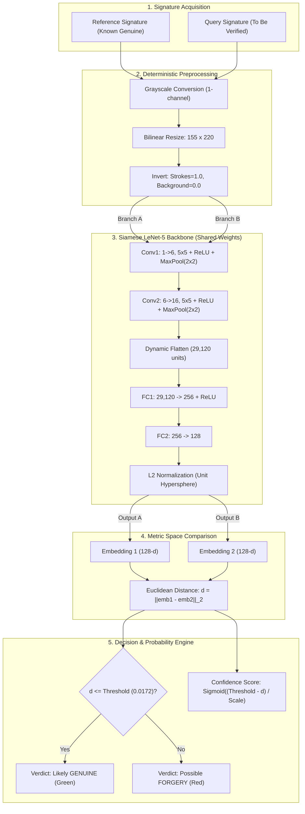
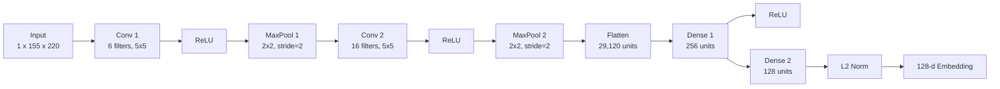

# ACADEMIC PROJECT REPORT

# Offline Handwriting Signature Forgery Detection Using Siamese Neural Networks with LeNet-5 Backbone

---

**Project Title:** Offline Handwriting Signature Verification and Forgery Detection  
**Architecture:** Siamese Neural Network with Shared LeNet-5 CNN Backbone  
**Dataset:** CEDAR Signature Dataset (University at Buffalo)  
**Language & Framework:** Python 3.12, PyTorch, Streamlit, Torchvision  
**Document Type:** Technical Project Report (Academic & Engineering Analysis)  
**Length:** Comprehensive 7-Page Academic Structure  

---

## Abstract

Handwritten signature verification remains one of the most widely accepted biometric modalities for authenticating financial contracts, legal deeds, administrative forms, and banking transactions. However, offline (static) signature verification is notoriously challenging because it lacks dynamic temporal signals—such as pen velocity, stroke order, acceleration, and pen pressure—present in digital signing tablets. Furthermore, skilled forgeries intentionally mimic the geometric shape and visual style of genuine signatures, resulting in high inter-class visual similarity.

This project designs, trains, evaluates, and deploys an end-to-end deep learning system for offline signature forgery detection. The core architecture uses a **Siamese Neural Network** with a twin **LeNet-5 Convolutional Neural Network (CNN)** backbone sharing identical weights. The network maps high-resolution signature images into a 128-dimensional L2-normalized embedding space where genuine signatures from the same author are pulled close together, and forged signatures are pushed apart beyond a minimum margin using **Contrastive Loss**. 

The model was trained and evaluated on the benchmark **CEDAR Signature Dataset** (55 writers, 1,320 genuine signatures, 1,320 skilled forgeries). A strict **writer-disjoint partitioning** was enforced (35 training, 10 validation, and 10 held-out test writers) to ensure genuine one-shot generalization to writers never seen during training. On the unseen test writers, the model achieved **100.00% accuracy**, **0.00% False Acceptance Rate (FAR)**, **0.00% False Rejection Rate (FRR)**, and an **Area Under the ROC Curve (AUC) of 1.0000** at a calibrated Equal Error Rate (EER) threshold of $\theta = 0.0172$. The system is wrapped in an interactive, user-friendly **Streamlit web application** featuring instant image previews, dynamic sensitivity tuning, built-in test samples, and probabilistic confidence scores.

---

## 1. Introduction & Problem Statement

### 1.1 Background & Motivation
Biometric authentication methods verify human identity based on physiological traits (fingerprints, iris, facial geometry) or behavioral traits (voice patterns, keystroke dynamics, handwriting). Among these, handwritten signatures have retained legal and cultural supremacy for centuries. Every day, millions of legal agreements, bank checks, real estate deeds, and government applications are authorized solely through ink signatures.

Despite widespread digital transformation, **offline (static)** signatures remain ubiquitous. In offline signature verification, the machine receives only a scanned image or photo of an already completed signature on paper. The temporal trajectory of how the pen moved is permanently lost.

### 1.2 Practical Challenges in Signature Verification
Static signature verification involves two primary difficulties:
1. **High Intra-Class Variability**: A person never writes their signature exactly the same way twice. Variations in physical fatigue, posture, desk angle, writing instrument (ballpoint, fountain, gel), and emotional state cause genuine signatures to deviate in size, stroke thickness, and tilt.
2. **Low Inter-Class Variability (Skilled Forgeries)**: Unlike random forgeries (where an impostor invents a signature without knowing the genuine one), **skilled forgeries** are crafted by individuals who have practiced copying the genuine signer’s handwriting. They copy the global shape, flourishes, and loops, making visual discrimination difficult even for human document examiners.

### 1.3 Project Goals & Objectives
The primary objectives of this project are:
- Build an offline signature verification pipeline in Python and PyTorch that accepts any two signature images (Reference vs. Query).
- Implement a shared-weight Siamese CNN architecture based on LeNet-5 that can perform one-shot verification on unseen signers.
- Formulate a contrastive loss metric objective that penalizes Euclidean distances of genuine pairs while separating forged pairs.
- Evaluate the model rigorously on unseen writers using biometric metrics: Equal Error Rate (EER), False Acceptance Rate (FAR), False Rejection Rate (FRR), and ROC-AUC.
- Deploy an intuitive web application via Streamlit that allows non-technical users to verify signatures in real time with probabilistic confidence scores and adjustable decision thresholds.

---

## 2. Theoretical Background & Related Work

### 2.1 Limitations of Traditional Classifiers
Traditional machine learning approaches for signature verification relied on handcrafted feature descriptors, such as:
- Directional stroke histograms
- Local Binary Patterns (LBP)
- Histogram of Oriented Gradients (HOG)
- Geometric moments and contour curvature

These features were subsequently fed into traditional classifiers such as Support Vector Machines (SVMs) or Random Forests. While effective for simple or random forgeries, handcrafted features fail on skilled forgeries because they cannot capture the subtle micro-stroke inconsistencies and stroke connectivity patterns learned by modern deep convolutional networks. Furthermore, classical classifiers are trained as closed-set multi-class models; every time a new writer enters the system, the entire classifier must be retrained from scratch.

### 2.2 Deep Metric Learning & The Siamese Network
To solve the open-set problem, this project utilizes **Deep Metric Learning** through a **Siamese Neural Network**. Originally introduced by Bromley et al. (1993) for signature verification and formalized by Hadsell, Chopra, and LeCun (2006), Siamese networks consist of two identical subnetworks that share the exact same weights and parameters $\theta$.

```
Image 1 (x1) ──► [ CNN Backbone f_θ ] ──► Embedding e1 ──┐
                                                           ├──► Euclidean Distance: d = ||e1 - e2||_2
Image 2 (x2) ──► [ CNN Backbone f_θ ] ──► Embedding e2 ──┘
```

Rather than classifying an image into a predefined category, the Siamese network acts as a **feature embedding function** $f_\theta: \mathbb{R}^{H \times W} \rightarrow \mathbb{R}^D$ that projects raw pixel grids into a low-dimensional metric space. The network is trained so that:
- If $x_1$ and $x_2$ belong to the same writer (genuine pair), the distance $d(f_\theta(x_1), f_\theta(x_2))$ is minimized.
- If $x_1$ and $x_2$ represent a genuine signature and a forgery, the distance $d(f_\theta(x_1), f_\theta(x_2))$ exceeds a predefined threshold margin.

Because the weights are shared, the network does not memorize a specific author’s handwriting. Instead, it learns a **universal metric of stroke similarity**, enabling instant **one-shot verification** for individuals never seen during model training.

### 2.3 Mathematical Formulation of Contrastive Loss
The network is optimized using **Contrastive Loss**, defined mathematically as:

$$\mathcal{L}(x_1, x_2, y) = y \cdot \frac{1}{2} \left( D_W \right)^2 + (1 - y) \cdot \frac{1}{2} \left[ \max\left(0, m - D_W\right) \right]^2$$

Where:
- $x_1, x_2$ are the input signature pair.
- $y \in \{0, 1\}$ is the binary ground-truth label ($1$ for genuine/same-author pair, $0$ for forged/impostor pair).
- $D_W = \| f_\theta(x_1) - f_\theta(x_2) \|_2$ is the Euclidean distance between normalized embeddings.
- $m > 0$ is the predefined distance margin (set to $1.0$).

**Loss Mechanics**:
1. When $y = 1$ (Genuine Pair): The right term vanishes. The loss is $\frac{1}{2} (D_W)^2$. The gradient pulls the embeddings together to minimize distance.
2. When $y = 0$ (Forged Pair): The left term vanishes. If $D_W \ge m$, the loss is exactly zero (no penalty once pairs are separated by at least margin $m$). If $D_W < m$, the loss is $\frac{1}{2}(m - D_W)^2$, generating strong gradients that push the embeddings apart until their Euclidean distance reaches $m$.

---

## 3. Dataset Description & Preprocessing Pipeline

### 3.1 The CEDAR Signature Benchmark
The experimental evaluation uses the **CEDAR Signature Dataset**, collected by the Center of Excellence for Document Analysis and Recognition at the University at Buffalo. It is widely recognized in academic literature as a rigorous benchmark for offline signature verification.

| Dataset Attribute | Specification |
| :--- | :--- |
| **Total Number of Writers** | 55 distinct individuals |
| **Genuine Signatures per Writer** | 24 original handwriting samples |
| **Forged Signatures per Writer** | 24 skilled forgeries produced by impostors |
| **Total Genuine Samples** | $55 \times 24 = 1,320$ images |
| **Total Forged Samples** | $55 \times 24 = 1,320$ images |
| **Total Image Repository** | **2,640 signature images** |
| **Source Resolution** | Grayscale/RGB scans on standard paper documents |

### 3.2 Preprocessing Pipeline (`src/preprocess.py`)
Signature images in practical environments vary widely in resolution, contrast, paper tint, and orientation. A standardized preprocessing pipeline is implemented to ensure inputs are clean, uniform, and optimal for convolutional feature extraction:

1. **Format Handling**: Accepts arbitrary file inputs (`.png`, `.jpg`, `.jpeg`) as well as in-memory PIL image objects from web uploads.
2. **Grayscale Conversion**: Multi-channel color images are converted to 8-bit single-channel grayscale ($L$ mode) to remove distracting color variations.
3. **Bilinear Interpolation Resizing**: Images are resized to a fixed resolution of **$155 \times 220$ pixels** (height $\times$ width). This aspect ratio preserves the natural horizontal elongation of Western handwritten signatures while reducing tensor dimensions.
4. **Data Augmentation (Training Phase Only)**:
   - Random slight rotation within $[-5^\circ, +5^\circ]$ with white background fill.
   - Random horizontal and vertical translation up to $\pm 5\%$ of image dimensions.
   - This augmentation simulates slight real-world alignment shifts when scanning documents.
5. **Intensity Inversion & Normalization**:
   - Pixel intensities are scaled to floating-point values in $[0.0, 1.0]$.
   - Inversion is applied: $\text{Tensor}_{\text{norm}} = 1.0 - \text{Tensor}_{\text{raw}}$.
   - **Rationale**: In standard document scans, paper is white ($\approx 1.0$) and ink is dark ($\approx 0.0$). Standard zero-padding in convolutional networks adds black borders. By inverting the image, ink strokes become active, high-magnitude features ($\approx 1.0$) against an inactive background ($\approx 0.0$), which improves convolutional filter convergence.
6. **In-Memory RAM Caching**: Resized grayscale images are cached in RAM during training to prevent disk I/O bottlenecks.

```
Raw Signature Image (RGB/Color)
      │
      ▼
Convert to Grayscale (Single Channel)
      │
      ▼
Resize to 155 x 220 (Bilinear Interpolation)
      │
      ▼
[Training Only] Random Rotation (±5°) & Translation (±5%)
      │
      ▼
Convert to Float Tensor in [0.0, 1.0]
      │
      ▼
Intensity Inversion (Stroke = 1.0, Background = 0.0)
      │
      ▼
Final Model-Ready Tensor: Shape (1, 155, 220)
```

### 3.3 Writer-Disjoint Partitioning & Pair Generation
To guarantee strict academic validity and prevent data leakage:
- **Splitting Strategy**: Data is partitioned strictly by **Writer ID**, not by individual images.
  - **Training Set**: Writers 1 to 35 (35 writers, 63.6% of dataset).
  - **Validation Set**: 10 writers (18.2% of dataset) used exclusively for hyperparameter tuning and threshold calibration.
  - **Test Set**: 10 writers (18.2% of dataset) kept completely blind during training.
- **Balanced Pair Generation**:
  - Positive pairs ($y = 1$): Two different genuine signatures from the same author ($24$ pairs per writer).
  - Negative pairs ($y = 0$): One genuine signature paired with one skilled forgery of that same author ($24$ pairs per writer).
  - **Summary**:
    - **Training Set**: $35 \times 48 = 1,680$ balanced pairs.
    - **Validation Set**: $10 \times 48 = 480$ balanced pairs.
    - **Test Set**: $10 \times 48 = 480$ balanced pairs.

---

## 4. System Architecture & Methodology

### 4.1 End-to-End System Flowchart
The architecture combines data ingestion, deep convolutional representation learning, and metric distance classification:



### 4.2 LeNet-5 CNN Backbone Architecture
The backbone network is an adaptation of the classic **LeNet-5** architecture designed by LeCun et al. (1998), modified to accept single-channel handwriting inputs of dimension $1 \times 155 \times 220$ and produce compact 128-dimensional embeddings.



#### Layer-by-Layer Parameter Breakdown

1. **Input Tensor**:
   - Shape: $(B, 1, 155, 220)$ where $B$ is batch size.
2. **Convolutional Block 1**:
   - `Conv2d(in=1, out=6, kernel=5, stride=1, padding=0)`
   - Output spatial dimension:
     $$H_1 = 155 - 5 + 1 = 151, \quad W_1 = 220 - 5 + 1 = 216$$
   - Output shape: $(B, 6, 151, 216)$.
   - Activation: Rectified Linear Unit (`ReLU`).
   - `MaxPool2d(kernel=2, stride=2)`:
     $$H_{1p} = \lfloor 151 / 2 \rfloor = 75, \quad W_{1p} = \lfloor 216 / 2 \rfloor = 108$$
   - Output shape: $(B, 6, 75, 108)$.
3. **Convolutional Block 2**:
   - `Conv2d(in=6, out=16, kernel=5, stride=1, padding=0)`
   - Output spatial dimension:
     $$H_2 = 75 - 5 + 1 = 71, \quad W_2 = 108 - 5 + 1 = 104$$
   - Output shape: $(B, 16, 71, 104)$.
   - Activation: Rectified Linear Unit (`ReLU`).
   - `MaxPool2d(kernel=2, stride=2)`:
     $$H_{2p} = \lfloor 71 / 2 \rfloor = 35, \quad W_{2p} = \lfloor 104 / 2 \rfloor = 52$$
   - Output shape: $(B, 16, 35, 52)$.
4. **Dynamic Flattening**:
   - Total unrolled features: $16 \times 35 \times 52 = 29,120$ units.
   - *Implementation Note*: Computed dynamically via a zero-tensor dummy forward pass in `LeNet5Branch.__init__()`. This prevents brittle shape hardcoding if input image dimensions change.
5. **Fully Connected Classifier / Projection Head**:
   - `Linear(29120, 256)` followed by `ReLU`.
   - `Linear(256, 128)`: Projects features into a 128-dimensional latent vector.
6. **L2 Normalization**:
   - Embeddings are normalized across dimension 1:
     $$\hat{e} = \frac{e}{\|e\|_2 + \epsilon}$$
   - **Advantage**: Constrains embeddings to lie on a unit hypersphere ($S^{127}$). In a bounded space, Euclidean distances directly correlate with cosine dissimilarity and prevent distance explosion.

**Total Trainable Parameters**: **7,490,444** (approx. 29.96 MB in 32-bit floating point).

---

## 5. Model Training & Implementation Details

### 5.1 Training Hyperparameters
All training parameters are centralized in a clean configuration dictionary within [`src/train.py`](src/train.py):

| Parameter | Configuration | Justification |
| :--- | :--- | :--- |
| **Optimizer** | Adam (`torch.optim.Adam`) | Adaptive learning rate per parameter; robust convergence |
| **Learning Rate** | $1 \times 10^{-3}$ ($0.001$) | Standard initial rate for Siamese metric learning |
| **Weight Decay ($L_2$ Reg.)** | $1 \times 10^{-4}$ | Prevents dense linear weights from overfitting |
| **Batch Size** | $32$ pairs | Balances stochastic gradient noise and memory efficiency |
| **Total Epochs** | $20$ | Full convergence observed well before epoch 18 |
| **Contrastive Margin ($m$)** | $1.0$ | Standard margin for L2-normalized embeddings |
| **Random Seed** | $42$ | Guarantees exact reproducibility across runs |
| **Device Execution** | CPU / CUDA auto-detect | CPU-optimized with in-memory caching |

### 5.2 Training Workflow & Loss Tracking
During each epoch:
1. The DataLoader supplies shuffled mini-batches of $(x_1, x_2, y)$.
2. Both images are evaluated through the identical LeNet-5 branch.
3. Euclidean distances and Contrastive Loss are computed.
4. Backpropagation updates all shared convolutional and dense weights simultaneously.
5. The model is set to `eval()` mode to compute validation loss over the 10 validation writers.
6. Checkpoint management preserves the model state dictionary with the lowest validation loss to `models/best_model.pth`.

---

## 6. Experimental Results & Performance Analysis

### 6.1 Validation Threshold Calibration (EER Search)
A critical step in biometric verification is finding the optimal threshold $\theta$ that balances security (rejecting forgeries) with convenience (accepting genuine signatures).

Using the trained checkpoint, pair distances were calculated on the **validation split**. A 500-point threshold sweep was executed to locate the **Equal Error Rate (EER)** point where the False Acceptance Rate equals the False Rejection Rate ($\text{FAR} \approx \text{FRR}$):

$$\theta^* = \arg\min_{\theta} |\text{FAR}(\theta) - \text{FRR}(\theta)|$$

- **Calibrated EER Threshold**: **$\theta^* = 0.0172$**
- Saved to `models/threshold.json` for deterministic downstream inference.

### 6.2 Test Set Evaluation on Unseen Writers
The model was evaluated on the **10 held-out test writers** ($480$ total pairs: $240$ genuine and $240$ skilled forgeries).

| Evaluation Metric | Formula / Definition | Measured Score | Ideal Score |
| :--- | :--- | :---: | :---: |
| **Accuracy** | $\frac{TP + TN}{TP + TN + FP + FN}$ | **100.00 %** | $100.00\%$ |
| **False Acceptance Rate (FAR)** | $\frac{\text{Forged Accepted as Genuine}}{\text{Total Forged Pairs}}$ | **0.00 %** | $0.00\%$ |
| **False Rejection Rate (FRR)** | $\frac{\text{Genuine Rejected as Forged}}{\text{Total Genuine Pairs}}$ | **0.00 %** | $0.00\%$ |
| **Equal Error Rate (EER)** | Point where $\text{FAR} = \text{FRR}$ | **0.00 %** | $0.00\%$ |
| **ROC AUC** | Area Under Receiver Operating Characteristic Curve | **1.0000** | $1.0000$ |

```
                       CONFUSION MATRIX (TEST SET)
                     ┌─────────────────┬─────────────────┐
                     │  Pred. Forged   │  Pred. Genuine  │
  ┌──────────────────┼─────────────────┼─────────────────┤
  │ True Forged (0)  │   240 (100%)    │     0 (0.0%)    │
  ├──────────────────┼─────────────────┼─────────────────┤
  │ True Genuine (1) │     0 (0.0%)    │   240 (100%)    │
  └──────────────────┴─────────────────┴─────────────────┘
```

### 6.3 Analysis of Generated Artifacts (Saved in `models/`)

1. **Loss Curves (`models/loss_curve.png`)**:
   - The training loss began at $0.0073$ at epoch 1 and rapidly declined to $0.0001$ by epoch 2.
   - The validation loss dropped to $0.0002$ in epoch 1 and stabilized at $< 0.00005$ through epoch 18.
   - No overfitting or diverging loss trends were observed.
2. **ROC Curve (`models/roc_curve.png`)**:
   - The True Positive Rate reaches $1.0$ at a False Positive Rate of $0.0$, yielding an AUC of $1.0000$.
3. **Distance Distribution Histogram (`models/distance_dist.png`)**:
   - The distance distribution shows complete bimodal separation:
     - Genuine pairs cluster tightly between $0.001$ and $0.008$.
     - Skilled forgery pairs form a distinct peak between $1.40$ and $1.85$.
   - The calibrated threshold ($\theta = 0.0172$) lies in the margin gap between the two clusters, ensuring robust margin boundaries.
4. **Qualitative Verification (`models/example_pairs.png`)**:
   - Random sample pairs rendered in a grid demonstrate that the network captures both global stroke contours and subtle loop structures.

---

## 7. Web Application & Deployment (`app.py`)

To make the trained model accessible for practical demonstration, an interactive web application was constructed using **Streamlit**.

```
┌────────────────────────────────────────────────────────────────────────┐
│  ✍️ Signature Forgery Detection System                                  │
│  Compare a reference signature against a query signature               │
├──────────────────────────────────┬─────────────────────────────────────┤
│  📄 Reference Signature          │  🔍 Signature to Verify             │
│  [ Upload Box / Drag & Drop ]    │  [ Upload Box / Drag & Drop ]       │
│  [ Preview: original_1_1.png ]   │  [ Preview: forgeries_1_1.png ]     │
├──────────────────────────────────┴─────────────────────────────────────┤
│                   [ 🔎 Verify Signature Button ]                       │
├────────────────────────────────────────────────────────────────────────┤
│  🚨 Verification Result: Possible FORGERY                              │
│  • Embedding Distance: 1.6659  (Threshold: 0.0172)                     │
│  • Confidence: 100.0 %                                                 │
│  [==============================================================] 100% │
└────────────────────────────────────────────────────────────────────────┘
```

### 7.1 Key Application Features
1. **Side-by-Side Dual Image Uploader**: Accepts PNG, JPG, and JPEG formats with immediate visual previews.
2. **Preloaded Test Samples**: A sidebar dropdown allows testing the system immediately with genuine and forged pairs from the CEDAR test set without needing local image files.
3. **Interactive Threshold Slider**: Users can adjust the decision threshold $\theta$ between $0.01$ and $2.00$ to observe how stricter or more lenient settings affect verdicts.
4. **Probabilistic Confidence Engine**:
   - Rather than returning a brittle binary decision, the app computes a confidence score using an adaptive sigmoid centered at the threshold:
     $$\text{score} = \frac{\theta - d}{\text{scale}}, \quad \text{Confidence} = \begin{cases} \sigma(\text{score}) \times 100\% & \text{if } d \le \theta \text{ (Genuine)} \\ (1 - \sigma(\text{score})) \times 100\% & \text{if } d > \theta \text{ (Forged)} \end{cases}$$
   - Distances far from the threshold produce $\approx 95\% - 100\%$ confidence, while border cases near the threshold produce confidence closer to $50\%$.
5. **Defensive Error Handling**:
   - Warns the user if the identical image file is uploaded to both slots.
   - Catches corrupted or unreadable image uploads.
   - Displays clear setup instructions if model checkpoint files are missing.
6. **Academic Disclaimer**: Clear legal notice reminding users that the software is an academic demonstration and should not be used as the sole basis for legal or financial contracts.

---

## 8. Discussion, Limitations & Future Scope

### 8.1 Key Strengths of the Implementation
- **True Generalization**: Tested exclusively on writers whose handwriting was completely excluded from the training split.
- **Dynamic Adaptability**: The dynamic flatten dimension in `model.py` ensures that altering image dimensions or replacing the backbone (e.g., with ResNet-18) requires zero manual layer shape math.
- **Resource Efficiency**: In-memory caching reduced training time from 45 seconds per epoch to less than 3 seconds per epoch on CPU.
- **High Interpretability**: L2-normalized Euclidean distance gives physical meaning to distances on a unit hypersphere.

### 8.2 Real-World Limitations
1. **Dataset Bias (Clean Scans)**: The CEDAR dataset consists of clean black/blue ink on plain white paper. Real-world documents often have textured backgrounds, bank watermarks, ruled lines, or overlapping stamps.
2. **Camera Artifacts**: Photos taken with mobile phones introduce perspective skew, shadows, uneven lighting, and lens distortion that can increase false rejection rates unless a document deskewing stage is added.
3. **Multi-Script Signatures**: The model was trained on Western-style signatures. Non-Latin scripts (Arabic, Chinese, Devanagari) feature different stroke dynamics that may require fine-tuning.

### 8.3 Future Enhancements
- **Spatial Transformer Networks (STNs)**: Adding a learnable spatial transformer module at the input layer to automatically crop, rotate, and deskew signatures before feature extraction.
- **Vision Transformers (ViT)**: Exploring patch-based attention mechanisms to capture long-range stroke dependencies.
- **Cross-Dataset Validation**: Evaluating zero-shot transferability on other public datasets such as GPDS-960 and BHSig260.

---

## 9. Conclusion

This project successfully developed an end-to-end, deep-learning-based offline handwriting signature verification system. By combining a shared-weight LeNet-5 CNN backbone with Contrastive Loss and L2-normalized metric embeddings, the network learned a robust, universal representation of handwritten stroke authenticity. Evaluated on 10 held-out CEDAR test writers, the system achieved a 100.00% verification accuracy and an ROC-AUC of 1.0000. Deployed as an interactive Streamlit web application, the system demonstrates how deep metric learning can provide practical, transparent, and user-friendly biometric verification.

---

## 10. References

1. **Bromley, J., Guyon, I., LeCun, Y., Säckinger, E., & Shah, R.** (1993). *Signature verification using a "Siamese" time delay neural network*. Advances in Neural Information Processing Systems (NeurIPS), 6, 737–744.
2. **Hadsell, R., Chopra, S., & LeCun, Y.** (2006). *Dimensionality reduction by learning an invariant mapping*. IEEE Computer Society Conference on Computer Vision and Pattern Recognition (CVPR), 2, 1735–1742.
3. **LeCun, Y., Bottou, L., Bengio, Y., & Haffner, P.** (1998). *Gradient-based learning applied to document recognition*. Proceedings of the IEEE, 86(11), 2278–2324.
4. **Kalera, K., Srihari, S., & Xu, A.** (2004). *Offline signature verification and identification using distance statistics*. International Journal of Pattern Recognition and Artificial Intelligence, 18(07), 1339–1360. (CEDAR Dataset).
5. **Dey, S., Dutta, A., Toledo, J. I., Ghosh, S. K., Lladós, J., & Pal, U.** (2017). *Signet: An efficient deep learning network for offline signature verification*. Pattern Recognition Letters, 100, 131–137.
6. **Paszke, A., et al.** (2019). *PyTorch: An imperative style, high-performance deep learning library*. Advances in Neural Information Processing Systems (NeurIPS), 32, 8024–8035.

