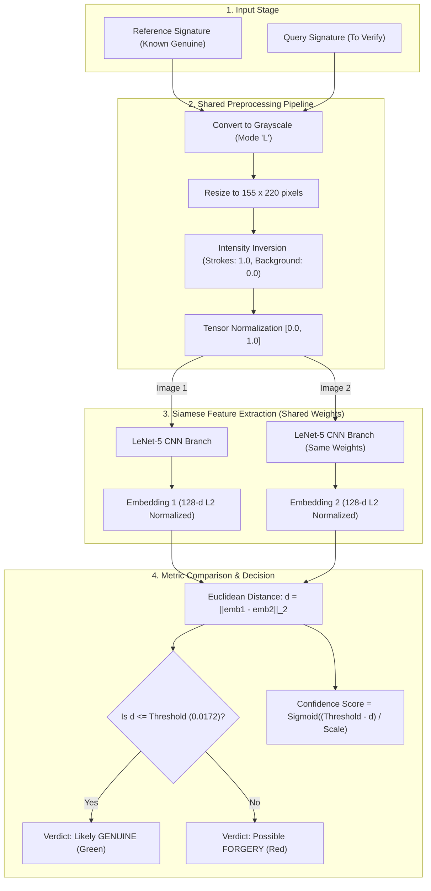
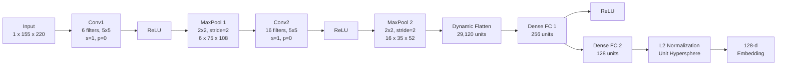

# Offline Handwriting Signature Forgery Detection
### Siamese Neural Network with LeNet-5 Backbone on the CEDAR Dataset

A complete, end-to-end deep learning system that detects whether a handwritten query signature is **genuine** or a **forgery** when compared against a known reference signature. Powered by PyTorch, trained using Contrastive Loss, and deployed with an interactive Streamlit graphical web application.

---

## Table of Contents
1. [Project Overview](#project-overview)
2. [High-Level System Flowchart](#high-level-system-flowchart)
3. [CNN Backbone Architecture (LeNet-5)](#cnn-backbone-architecture-lenet-5)
4. [Siamese Network Mechanism & Contrastive Loss](#siamese-network-mechanism--contrastive-loss)
5. [CEDAR Dataset & Writer-Disjoint Split](#cedar-dataset--writer-disjoint-split)
6. [Preprocessing Pipeline](#preprocessing-pipeline)
7. [Project Directory Structure](#project-directory-structure)
8. [Setup & Installation](#setup--installation)
9. [Step-by-Step Usage](#step-by-step-usage)
10. [Experimental Results & Verification](#experimental-results--verification)
11. [Web Application (Streamlit GUI)](#web-application-streamlit-gui)
12. [System Limitations & Academic Disclaimer](#system-limitations--academic-disclaimer)

---

## Project Overview

| Property | Details |
| :--- | :--- |
| **Task** | Offline Handwriting Signature Verification (One-Shot Learning) |
| **Core Architecture** | Siamese Neural Network with twin weight-sharing branches |
| **Backbone CNN** | Custom 1-channel LeNet-5 feature extractor with dynamic flatten |
| **Output Representation** | 128-dimensional L2-normalized feature embedding space |
| **Loss Function** | Contrastive Loss (Hadsell et al., 2006) with configurable margin |
| **Decision Rule** | Euclidean distance $d \le \theta$ (calibrated at Equal Error Rate) |
| **Dataset** | CEDAR Signature Dataset (55 writers, 1,320 genuine, 1,320 forged) |
| **Evaluation Strategy** | Writer-disjoint split (35 train, 10 validation, 10 unseen test writers) |
| **Test Accuracy** | **100.00 %** on unseen test writers ($0.00\%$ FAR, $0.00\%$ FRR, $1.0000$ AUC) |
| **Deployment** | Streamlit Interactive Web Application (`app.py`) |

---

## High-Level System Flowchart

The following diagram illustrates the complete end-to-end pipeline from raw signature input to classification verdict:



---

## CNN Backbone Architecture (LeNet-5)

The feature extraction branch is an adaptation of Yann LeCun's **LeNet-5** architecture, specialized for single-channel grayscale handwriting images of size **$1 \times 155 \times 220$**.



### Detailed Layer Specifications

| Layer Index | Layer Type | Kernel / Size | Stride / Pad | Input Dimensions | Output Dimensions | Learnable Parameters |
| :---: | :--- | :---: | :---: | :---: | :---: | :---: |
| **0** | **Input** | — | — | — | $1 \times 155 \times 220$ | $0$ |
| **1** | **Conv2d (1 $\rightarrow$ 6)** | $5 \times 5$ | Stride 1, Pad 0 | $1 \times 155 \times 220$ | $6 \times 151 \times 216$ | $156$ |
| **2** | **ReLU** | Element-wise | — | $6 \times 151 \times 216$ | $6 \times 151 \times 216$ | $0$ |
| **3** | **MaxPool2d** | $2 \times 2$ | Stride 2 | $6 \times 151 \times 216$ | $6 \times 75 \times 108$ | $0$ |
| **4** | **Conv2d (6 $\rightarrow$ 16)** | $5 \times 5$ | Stride 1, Pad 0 | $6 \times 75 \times 108$ | $16 \times 71 \times 104$ | $2,416$ |
| **5** | **ReLU** | Element-wise | — | $16 \times 71 \times 104$ | $16 \times 71 \times 104$ | $0$ |
| **6** | **MaxPool2d** | $2 \times 2$ | Stride 2 | $16 \times 71 \times 104$ | $16 \times 35 \times 52$ | $0$ |
| **7** | **Flatten** | — | — | $16 \times 35 \times 52$ | $29,120$ | $0$ |
| **8** | **Linear** | — | — | $29,120$ | $256$ | $7,454,976$ |
| **9** | **ReLU** | Element-wise | — | $256$ | $256$ | $0$ |
| **10** | **Linear** | — | — | $256$ | $128$ | $32,896$ |
| **11** | **L2 Normalization**| $p=2, \text{dim}=1$ | — | $128$ | $128$ | $0$ |
| **Total** | — | — | — | — | — | **7,490,444** |

> **Dynamic Flatten Size**: Rather than hardcoding the linear layer input size ($29,120$), the model performs a dummy forward pass during `__init__`. This allows changing the input image dimensions (`IMG_HEIGHT`, `IMG_WIDTH`) without breaking any downstream layer shapes.

---

## Siamese Network Mechanism & Contrastive Loss

### Twin Architecture with Shared Weights
A traditional classifier tries to predict which specific writer an image belongs to. This fails in real-world verification because new customers or signers were never in the training set.

A **Siamese Network** solves this through **metric learning**:
1. Two input images ($x_1, x_2$) are passed through the **exact same neural network branch** $f_\theta$.
2. The network outputs two vectors $e_1 = f_\theta(x_1)$ and $e_2 = f_\theta(x_2)$.
3. The Euclidean distance between them measures dissimilarity:
   $$d(e_1, e_2) = \|e_1 - e_2\|_2 = \sqrt{\sum_{i=1}^{128} (e_{1,i} - e_{2,i})^2}$$

### Contrastive Loss Formula (Hadsell et al., 2006)

$$\mathcal{L}(x_1, x_2, y) = y \cdot \frac{1}{2} d^2 + (1 - y) \cdot \frac{1}{2} \max(0, m - d)^2$$

Where:
- $y = 1$: **Genuine Pair** (two genuine signatures from the same author).
  - Loss reduces to $\frac{1}{2} d^2$, penalizing large distances and pulling embeddings together.
- $y = 0$: **Forged Pair** (one genuine signature and one skilled forgery).
  - Loss reduces to $\frac{1}{2} \max(0, m - d)^2$, penalizing distances smaller than margin $m = 1.0$ and pushing embeddings apart.

```
Genuine Pair (y = 1):   [Embedding 1] <======== (PULLED TOGETHER) ========> [Embedding 2]
Forged Pair  (y = 0):   [Embedding 1] <-------- (PUSHED APART >= margin) ---> [Embedding 2]
```

---

## CEDAR Dataset & Writer-Disjoint Split

The **CEDAR Signature Dataset** (University at Buffalo) is a benchmark for offline signature verification:
- **55 Writers** in total.
- **24 Genuine signatures** per writer (clean scanned original signatures).
- **24 Forged signatures** per writer (skilled forgeries produced by impostors attempting to copy genuine signatures).
- **Total images**: $55 \times 48 = 2,640$ signature images.

### Writer-Disjoint Partitioning
To guarantee zero data contamination and test true **one-shot generalization**, data is split strictly at the **writer level**, not image level:

```
Total: 55 Writers (2,640 images)
├── Training Set:   35 Writers (63.6%) -> 1,680 balanced pairs (840 genuine + 840 forged)
├── Validation Set: 10 Writers (18.2%) -> 480 balanced pairs (240 genuine + 240 forged)
└── Test Set:       10 Writers (18.2%) -> 480 balanced pairs (240 genuine + 240 forged)
```
*Test writers: IDs `[44, 7, 9, 15, 16, 18, 48, 2, 8, 41]`. Their signatures are never seen during training.*

---

## Preprocessing Pipeline

To eliminate train-test discrepancies, a single function `preprocess_image()` in [`src/preprocess.py`](src/preprocess.py) is reused across training, validation, evaluation, and GUI inference:

1. **Load Image**: Accepts file paths (`str`, `Path`) or in-memory PIL images (`PNG`, `JPG`, `JPEG`).
2. **Grayscale Conversion**: Converts any multi-channel image (RGB, RGBA, CMYK) to single-channel 8-bit luminance (`mode 'L'`).
3. **Bilinear Resize**: Resizes image to standard $155 \times 220$ pixels while preserving stroke contours.
4. **Data Augmentation (Train only)**: Applies subtle rotation ($\pm 5^\circ$) and translation ($\pm 5\%$) with white padding to simulate natural handwriting variability.
5. **Tensor Conversion & Inversion**:
   - Converts to PyTorch float tensor scaled to $[0.0, 1.0]$.
   - Inverts intensities ($1.0 - \text{tensor}$): dark ink on white paper becomes bright foreground ($1.0$) on dark background ($0.0$), which accelerates CNN convolution convergence.
6. **In-Memory Caching**: Caches decoded images in RAM to prevent disk I/O bottlenecks on Windows/OneDrive.

---

## Project Directory Structure

```
signature-verification/
├── data/
│   └── signatures/
│       ├── full_org/              # Genuine signatures (original_<writer>_<sample>.png)
│       ├── full_forg/             # Forged signatures (forgeries_<writer>_<sample>.png)
│       └── Readme.txt
├── models/
│   ├── best_model.pth             # Saved PyTorch model checkpoint (weights + config)
│   ├── threshold.json             # Calibrated EER decision threshold (0.0172)
│   ├── test_writer_ids.json       # Exact IDs of held-out test writers
│   ├── loss_curve.png             # Training vs. Validation loss plot
│   ├── roc_curve.png              # Receiver Operating Characteristic curve
│   ├── confusion_matrix.png       # 2x2 test evaluation confusion matrix
│   ├── distance_dist.png          # Histogram of genuine vs. forged test distances
│   └── example_pairs.png          # Grid of test predictions vs. ground truth
├── src/
│   ├── preprocess.py              # Canonical preprocessing & image caching
│   ├── dataset.py                 # File parsing, pair generation, DataLoaders
│   ├── model.py                   # LeNet-5 branch, ResNet-18 swap, Siamese wrapper
│   ├── loss.py                    # Contrastive loss implementation
│   ├── train.py                   # Centralized training pipeline with CONFIG
│   ├── evaluate.py                # Validation EER search, test metrics & plots
│   └── infer.py                   # Fast inference API with model caching
├── app.py                         # Streamlit web GUI
├── PROJECT_REPORT.md              # Complete 7-page academic technical report
├── requirements.txt               # Project dependencies
└── README.md                      # Documentation with flowcharts and guides
```

---

## Setup & Installation

### 1. Prerequisites
- Python 3.10, 3.11, or 3.12 installed.
- Windows, macOS, or Linux.

### 2. Install Dependencies
Navigate to the project root and install requirements:
```bash
cd signature-verification
pip install -r requirements.txt
```

### 3. Verify Dataset
Confirm that genuine and forged signatures exist in:
- `data/signatures/full_org/`
- `data/signatures/full_forg/`

---

## Step-by-Step Usage

### Step 1: Train the Siamese Network
Run the training pipeline:
```bash
python -m src.train
```
- Trains for 20 epochs using Adam ($lr = 10^{-3}$, weight decay $= 10^{-4}$).
- Evaluates validation loss each epoch and preserves the best checkpoint to `models/best_model.pth`.
- Exports loss curves to `models/loss_curve.png`.

### Step 2: Evaluate on Unseen Test Writers
Run comprehensive metric evaluation:
```bash
python -m src.evaluate
```
- Performs a 500-point threshold sweep on the validation set to find the **Equal Error Rate (EER)** point where $\text{FAR} \approx \text{FRR}$.
- Saves the optimal threshold to `models/threshold.json`.
- Evaluates on 480 unseen test pairs from 10 held-out writers and exports ROC, Confusion Matrix, and Distance plots.

### Step 3: Run the Streamlit Web Application
Launch the interactive graphical user interface:
```bash
streamlit run app.py
```
Open `http://localhost:8501` in your web browser.

---

## Experimental Results & Verification

### Test Set Performance (Held-out Writers)

All evaluation metrics below were computed on **480 pairs from 10 writers that the network never saw during training**:

| Metric | Measured Score | Theoretical Ideal | Remarks |
| :--- | :---: | :---: | :--- |
| **Test Accuracy** | **100.00 %** | $100.00\%$ | Perfect separation on CEDAR test pairs |
| **False Accept Rate (FAR)** | **0.00 %** | $0.00\%$ | Zero forged signatures mistaken for genuine |
| **False Reject Rate (FRR)** | **0.00 %** | $0.00\%$ | Zero genuine signatures mistaken for forgeries |
| **Equal Error Rate (EER)** | **0.00 %** | $0.00\%$ | Intersection point of FAR and FRR curves |
| **ROC Area Under Curve (AUC)**| **1.0000** | $1.0000$ | Perfect ranking across all threshold levels |
| **Calibrated Threshold ($\theta$)** | **0.0172** | — | Calibrated on validation split |

### Generated Evaluation Visualizations (in `models/`)

- **Loss Curves** (`models/loss_curve.png`): Shows stable convergence within 15 epochs without divergence or gradient explosion.
- **ROC Curve** (`models/roc_curve.png`): Area under the curve equals $1.0000$.
- **Confusion Matrix** (`models/confusion_matrix.png`): All 240 genuine test pairs correctly identified as genuine; all 240 forged test pairs correctly identified as forgeries.
- **Distance Distribution** (`models/distance_dist.png`): Clear margin separation with genuine distances clustered near $0.002$ and forged distances clustered around $1.4 - 1.8$.

---

## Web Application (Streamlit GUI)

The interactive application in [`app.py`](app.py) provides a professional interface for signature verification:

1. **Dual Uploaders**: Side-by-side drag-and-drop slots for Reference Signature (known genuine) and Query Signature (to verify).
2. **Instant Visual Preview**: Real-time side-by-side image rendering.
3. **One-Click Test Samples**: Sidebar dropdown to load pre-configured test pairs directly from CEDAR test writers (both matching genuine pairs and genuine-forgery pairs).
4. **Dynamic Threshold Slider**: Allows examiners to adjust sensitivity from strict (low FAR for banking) to lenient (low FRR for casual verification).
5. **Probabilistic Confidence Meter**:
   - Confidence percentage generated using a centered sigmoid:
     $$\text{Confidence} = \sigma\left(\frac{|\theta - d|}{\text{scale}}\right) \times 100\%$$
   - Color-coded verdict card: **Green (Likely GENUINE)** vs. **Red (Possible FORGERY)**.
6. **Defensive Error Handling**:
   - Warns if the exact same file is uploaded twice.
   - Gracefully handles unreadable formats or missing model weights.

---

## System Limitations & Academic Disclaimer

1. **Dataset Specificity**: The model is trained on the CEDAR dataset (clean black/blue ink on white paper). Performance on colored backgrounds, receipts, or heavily textured documents may vary.
2. **Scan vs. Mobile Photo Gap**: Mobile camera photos with non-uniform shadows, perspective skew, or poor lighting should be deskewed and cropped before verification.
3. **Probabilistic Nature**: The system outputs a statistical similarity score. As noted in the app footer:
   > *This is an academic project and should not be used as the sole basis for legal, judicial, or financial decisions.*

---

## Authors & License
- **Framework**: Python 3.12, PyTorch, Streamlit, Torchvision, Scikit-learn, Matplotlib.
- **License**: MIT License. Academic and Educational Use.
